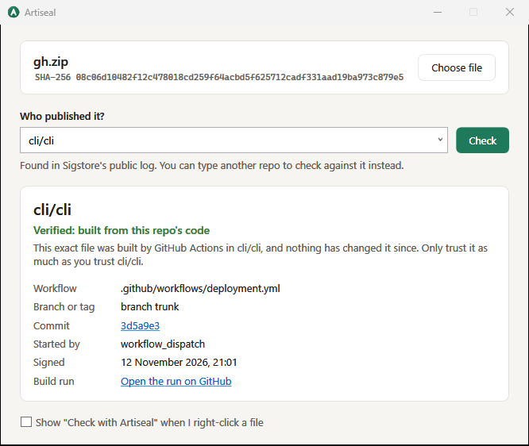
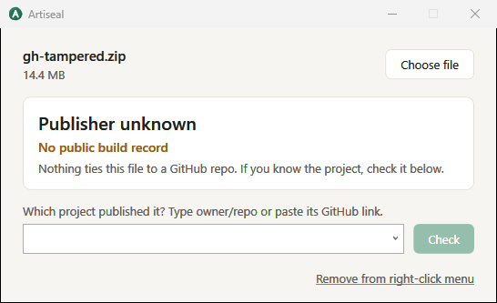
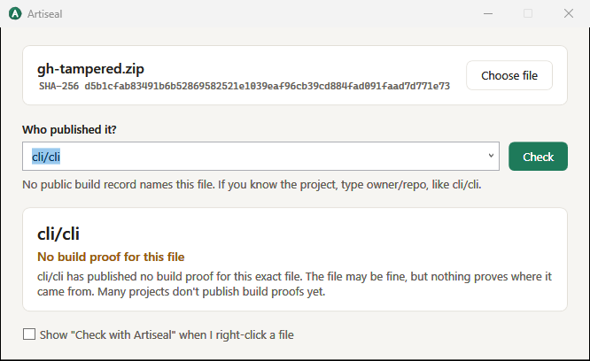

<p align="center">
  
</p>

<h1 align="center">Artiseal</h1>

<p align="center">
  <b>Right-click any downloaded file and find out where it was really built.</b>
</p>

<p align="center">
  
  
  
  
</p>

<p align="center">
  
</p>

You download `tool.zip` from a GitHub release. Was it really built from that project's code, or did someone swap it on the way? GitHub can prove it, but until now only from the command line, and only if you already knew which repo to ask.

Artiseal answers in one click. It finds who published the file, checks GitHub's signed build record for it, and shows you the repo, workflow, commit and build run that produced those exact bytes.

## Features

- **Nothing to type.** Artiseal finds the publishing repo from the file's fingerprint in Sigstore's public log, or from where your browser downloaded it.
- **Real cryptographic checks.** Every answer is verified with Sigstore: the signature, the certificate chain, the transparency log entry, and that the signed record names this exact file.
- **Shows its work.** Workflow file, branch or tag, commit, when it was signed, and a link to the build run on GitHub.
- **Honest about what it can't prove.** If a project publishes no build records, Artiseal says so instead of guessing.
- **Warns about look-alikes.** If more than one repo has signed the same file, you see all of them.
- **Right-click menu.** "Verify with Artiseal", with the app icon, on every file in Explorer. Turning it on asks for admin rights once.
- **Free and private.** No account, no server of ours, no tracking. It talks only to GitHub and Sigstore.

## Screenshots

| A file nobody vouches for | A file checked against a repo that never built it |
| --- | --- |
|  |  |

## Quick start

1. Download `Artiseal-<version>-win-x64.zip` from the [latest release](https://github.com/medovanx/Artiseal/releases/latest) and unzip it anywhere. It is a single `Artiseal.exe` with nothing to install and no .NET needed.
2. Open Artiseal and tick **Show "Verify with Artiseal" when I right-click a file**.
3. Right-click any downloaded file and choose **Verify with Artiseal**.

You can also drop a file on the window, or use **Choose file**.

### Command line

```text
artiseal gh_2.104.0_windows_amd64.zip
Signed by: cli/cli
Verified: Built by GitHub Actions in cli/cli.
  workflow .github/workflows/deployment.yml
  ref      refs/heads/trunk
  commit   3d5a9e355a837f2f5ee78d7484c118cc1342ad1a
  run      https://github.com/cli/cli/actions/runs/43283669119/attempts/1
```

Pass a repo to skip the lookup: `artiseal tool.zip owner/repo`. The exit code is 0 only when the file verified.

## How it works

1. **Fingerprint.** Artiseal computes the file's SHA-256.
2. **Find the publisher.** It reads the download address Windows saved with the file, or searches Sigstore's public transparency log for that fingerprint and reads the repo from the signing certificate. This only suggests where to look; nothing is trusted yet.
3. **Fetch the proof.** It asks GitHub's attestations API for that repo's build records for this fingerprint.
4. **Verify.** With Sigstore it checks the signature, the certificate chain back to Sigstore's root, the transparency log entry, that the signer is a GitHub Actions run in that exact repo, and that the signed record lists this file's fingerprint.

A green result means: this exact file was built by GitHub Actions in that repo and has not changed since. It is only as trustworthy as the repo itself, so Artiseal always leads with the repo name.

## What it can't check

- **Projects that publish no build records.** Adoption is growing (the GitHub CLI does it, for example), but many projects don't yet.
- **Private repos.** Their records aren't in the public log, and GitHub only serves them to signed-in members.
- **Anything built outside GitHub Actions.**

## Building

You need the [.NET 10 SDK](https://dotnet.microsoft.com/download) on Windows.

```text
dotnet build
dotnet test
```

The app is `src/Artiseal.App`, the command line tool is `src/Artiseal.Cli`, and the checking logic they share is `src/Artiseal.Core`. The tests run the real Sigstore checks on a real GitHub CLI release, including tampered and wrong-repo cases.

The icon is drawn in code by `tools/IconMaker`. To regenerate it:

```text
dotnet run --project tools/IconMaker -- src/Artiseal.App/Assets monogram
```

## Releases and versions

Artiseal follows [Semantic Versioning](https://semver.org): `MAJOR.MINOR.PATCH`. Every change is listed in the [changelog](CHANGELOG.md).

Pushing a tag such as `v0.2.0` runs the release workflow, which tests the code, builds the app and the command line tool, publishes them with a `SHA256SUMS.txt`, and adds GitHub build provenance for each download. So you can check an Artiseal download with Artiseal.

## FAQ

**Does Artiseal send my files anywhere?**
No. Only the file's SHA-256 fingerprint leaves your computer, to look it up at GitHub and Sigstore.

**Do I need a GitHub account?**
No. Without one, GitHub allows 60 requests an hour, which is about 30 checks. Set a `GITHUB_TOKEN` environment variable to raise that.

**A file shows "No build proof". Is it malware?**
Not necessarily. It means nothing proves where it came from. Treat it like any download you can't verify.

## License

[MIT](LICENSE)
